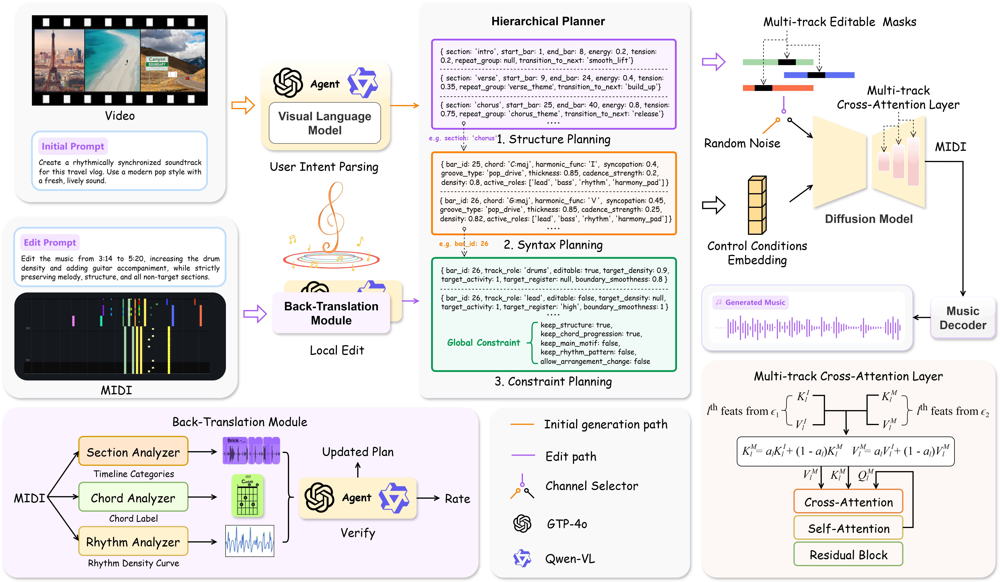

# VHCMusic

VHCMusic is a research-oriented implementation of **Verifiable Hierarchical Control for Music Generation with Local Editing and Back-Translation Verification**. The system converts user prompts or video descriptions into executable music plans, generates multitrack symbolic MIDI with conditional latent diffusion, edits local bar-track regions under masks, renders audio, and verifies whether the output follows the target plan.



## Project Introduction

**Paper Title:** VHCMusic: Verifiable Hierarchical Control for Music Generation with Local Editing and Back-Translation Verification

**Abstract:** Generative artificial intelligence is changing how music is produced for digital media. Existing methods usually encode visual features, text prompts, or music attribute labels as conditioning vectors for a generative model. This improves surface-level relevance between the input condition and the generated music, but it does not guarantee stable realization of user intent at the levels of structure, rhythm, harmony, and local editing. In practical creation scenarios, user prompts are often non-technical and subjective. A generation system may therefore suffer from ambiguous control targets, editing spillover, and drift in non-target attributes. This paper proposes VHCMusic, a hierarchical controllable music generation framework for local editing and control back-translation verification. The framework converts user prompts and visual cues into three intermediate representations: a structural plan, a musical-grammar plan, and realization constraints, to precisely generate multitrack music sequences. To verify whether control targets are actually realized, VHCMusic introduces a back-translation mechanism that reversely estimates the output music structure and compares it with the target plan. Extensive experiments have demonstrated its superior music generation quality and controllable editing capabilities. VHCMusic offers a plannable, editable, and verifiable computational framework for human-AI collaborative music creation.

VHCMusic has five main stages:

1. User intent parsing and hierarchical planning.
2. Multitrack MIDI event-grid encoding.
3. MIDI autoencoding and conditional latent diffusion.
4. Masked local editing with non-target preservation.
5. MIDI back-translation verification and closed-loop repair.

The hierarchical plan has three layers:

- **Structure planning**: sections, bar boundaries, energy, tension, repetition, transitions.
- **Syntax planning**: bar-level chord, harmonic function, groove, density, syncopation, texture thickness, active roles.
- **Constraint planning**: track/bar editability, target density/activity/register, boundary smoothness, and global preservation constraints.

The MIDI representation is a role-aligned event grid:

`X in R^{R x L x S x P x F}`

where `R` is track role count, `L` bars, `S` subdivisions per bar, `P` MIDI pitch bins, and `F` event features (`note_on`, `duration`, `velocity`).

## Datasets
We employ five publicly available music datasets, namely POP909, SymMV,
Slakh2100, SALAMI, and McGill Billboard, covering complementary aspects
of symbolic music generation, multitrack modeling, structural analysis,
and harmonic analysis. POP909 contains 909 Chinese pop songs with
symbolic MIDI arrangements and annotations including beat information,
key changes, and chord labels. The dataset provides melody, sub-melody,
and piano-accompaniment tracks and is primarily used to construct the
symbolic training data for the conditional diffusion generator.

SymMV contains 1,140 music-video pairs, including 1,000 training pairs,
70 validation pairs, and 70 test pairs, with symbolic annotations for
chords, rhythm, melody, and accompaniment. It is used mainly to support
video-cue-to-music generation and multimodal evaluation.

Slakh2100 contains 2,100 automatically mixed multitrack music pieces
with aligned MIDI files, corresponding to approximately 145 hours of
music. The dataset provides 4--48 instrument tracks per piece and covers
34 instrument categories derived from 187 sampled patches. It is used
to supplement multitrack MIDI representation learning, track-role
modeling, and multitrack cross-attention training.

SALAMI contains nearly 1,400 musical pieces with more than 2,400
structural annotations. Its annotations describe hierarchical musical
structure, including section boundaries and functional labels, and are
used exclusively for independent evaluation of the Section Analyzer,
particularly for boundary detection and structural-function estimation.

The McGill Billboard dataset provides chord and structural annotations
for a large collection of popular music. The released version 2.0
contains annotations and audio features corresponding to Billboard
chart samples, including 890 annotated entries representing 740
distinct songs. The annotations include chord labels, structural
information, instrumentation, timing, metre, and tonic information.
In this study, the dataset is used only for independent evaluation of
the Chord Analyzer, including chord-root, chord-quality, chord-transition,
and harmonic-sequence consistency.

To prevent information leakage, POP909, SymMV, and Slakh2100 are used
for generative-model training and testing with song-level separation
between the training, validation, and test subsets. SALAMI and McGill
Billboard are kept independent of conditional diffusion model training
and are used only for back-translation validation.


- POP909: https://github.com/music-x-lab/POP909-Dataset
- SymMV: https://github.com/zhuole1025/SymMV
- Slakh2100: https://zenodo.org/records/4599666
- SALAMI: https://github.com/DDMAL/salami-data-public
- Billboard: https://ddmal.ca/research/The_McGill_Billboard_Project_%28Chord_Analysis_Dataset%29


## Installation

Create the environment:
```bash
numpy>=1.23
scipy>=1.10
pandas>=1.5
tqdm>=4.65
PyYAML>=6.0
omegaconf>=2.3
jsonschema>=4.17
torch>=2.0
torchaudio>=2.0
mido>=1.3
miditoolkit>=0.1.16
pretty_midi>=0.2.10
librosa>=0.10
soundfile>=0.12
pyloudnorm>=0.1.1
matplotlib>=3.7
seaborn>=0.12
scikit-learn>=1.2
mir_eval>=0.7
pytest>=7.0
```

```bash
conda env create -f environment.yml
conda activate vhcmusic
pip install -r requirements.txt
```

For CPU-only development, install the CPU PyTorch wheel from the official PyTorch instructions and keep the same Python package requirements.

### FluidSynth

Install FluidSynth separately:

- Ubuntu: `sudo apt-get install fluidsynth`
- macOS: `brew install fluid-synth`
- Windows: install FluidSynth binaries and add the executable to `PATH`.

Download a GM-compatible SoundFont such as FluidR3 GM or GeneralUser GS and set it in `configs/render.yaml`:

```yaml
render:
  soundfont: /path/to/GeneralUser_GS.sf2
```

If the SoundFont is missing, rendering scripts stop with an explicit setup message.

### Optional Metrics

Some metrics require large external models:

- FAD: install `frechet-audio-distance` and provide reference statistics.
- CLAP similarity: install LAION-CLAP and provide model weights if needed.
- ImageBind similarity: install Meta ImageBind following its official repository.


# Dataset Preparation

VHCMusic does not download restricted datasets automatically. Obtain each dataset from its official source, accept the corresponding license, and place it under `data/raw`.

## Expected Layout

```text
data/raw/
  POP909/
    001/001.mid
    ...
  SymMV/
    <song_id>/*.mid
  slakh2100/
    <track_id>/*.mid
  SALAMI/
    annotations/*.txt or *.csv
    midi_optional/**/*.mid
  Billboard/
    annotations/*.lab or *.csv
    midi_optional/**/*.mid
```

## Sources

- POP909: use the official POP909 repository/release.
- SymMV: use the official SymMV dataset instructions from the authors.
- Slakh2100: use the official Slakh2100 release.
- SALAMI: use the official SALAMI structural annotation dataset; this project uses it for independent Section Analyzer validation.
- McGill Billboard: use the official McGill Billboard chord/structure annotations; this project uses it for independent Chord Analyzer validation.

## Preprocessing

```bash
python data/preprocess_pop909.py --input data/raw/POP909 --output data/processed/pop909
python data/preprocess_symmv.py --input data/raw/SymMV --output data/processed/symmv
python data/preprocess_slakh2100.py --input data/raw/slakh2100 --output data/processed/slakh2100
python data/preprocess_salami.py --input data/raw/SALAMI --output data/processed/salami
python data/preprocess_billboard.py --input data/raw/Billboard --output data/processed/billboard
python data/build_tasks.py --processed data/processed --output data/processed/tasks
```

Each MIDI preprocessing script writes:

- `train/*.npz`, `val/*.npz`, `test/*.npz`: event grid and condition plan.
- `items.jsonl`: source path, song id, split, bars.
- `splits.json`: song-level split mapping.

Splits are made by stable song id hashing, so fragments of the same song stay in the same split.

To generate MIDI latents after training an autoencoder:

```bash
python data/build_tasks.py --processed data/processed --output data/processed/tasks --autoencoder-checkpoint outputs/checkpoints/autoencoder.pt --config configs/train_vhcmusic.yaml
```

Typical preprocessing:

```bash
python data/preprocess_pop909.py --input data/raw/POP909 --output data/processed/pop909
python data/preprocess_slakh2100.py --input data/raw/slakh2100 --output data/processed/slakh2100
python data/build_tasks.py --processed data/processed --output data/processed/tasks
```

Splits are made by song id to prevent fragments of the same piece from appearing in both training and testing.

## Training

Train the MIDI autoencoder:

```bash
python scripts/train_autoencoder.py --config configs/train_vhcmusic.yaml
```

Train the conditional diffusion model:

```bash
python scripts/train_diffusion.py --config configs/train_vhcmusic.yaml --seed 16
```

Resume training:

```bash
python scripts/train_diffusion.py --config configs/train_vhcmusic.yaml --resume outputs/checkpoints/diffusion/last.pt
```

Run the configured multi-seed protocol:

```bash
for s in 16 2026 789; do python scripts/train_diffusion.py --config configs/train_vhcmusic.yaml --seed $s; done
```

## Inference

Text-to-MIDI:

```bash
python scripts/generate_music.py --config configs/train_vhcmusic.yaml --prompt examples/example_prompt.json --checkpoint outputs/checkpoints/diffusion/best.pt --bars 32
```

Video-conditioned symbolic planning uses the same path with a JSON prompt that contains a `video_description` field. The planner converts it to section, syntax, and realization plans before sampling.

Plan-conditioned generation:

```bash
python scripts/generate_music.py --config configs/train_vhcmusic.yaml --plan examples/example_plan.json --checkpoint outputs/checkpoints/diffusion/best.pt
```

Local editing:

```bash
python scripts/local_edit.py --config configs/edit_vhcmusic.yaml --midi original.mid --edit-request examples/example_edit_request.json
```

Closed-loop repair:

```bash
python scripts/closed_loop_repair.py --config configs/edit_vhcmusic.yaml --midi generated.mid --plan generated_plan.json
```

Render MIDI:

```bash
python scripts/render_midi.py --config configs/render.yaml --midi generated.mid --output outputs/render
```

## Evaluation

```bash
python data/build_tasks.py --processed data/processed --curated data/annotations/benchmark.jsonl --output data/processed/tasks
python scripts/calibrate_evaluation.py --training data/annotations/offline_train.jsonl --development data/annotations/offline_dev.jsonl
python scripts/run_benchmark.py --tasks data/processed/tasks/test_tasks.jsonl
python scripts/evaluate.py --config configs/eval_vhcmusic.yaml
python scripts/reproduce_tables.py --results outputs/eval/eval_summary.json
```

## Visualization

```bash
python -m vhcmusic.visualization.structure_similarity --audio Music.wav --plan generated_plan.json --output outputs/figures
python -m vhcmusic.visualization.harmony_chromagram --midi generated.mid --plan generated_plan.json --output outputs/figures
python -m vhcmusic.visualization.rhythm_alignment --audio Music.wav --plan generated_plan.json --output outputs/figures
python -m vhcmusic.visualization.local_edit_diff --before before.wav --after after.wav --output outputs/figures
```

Figures are saved as 300 dpi PNG and PDF.

## Configuration

Important fields:

- `data.max_bars`, `data.subdivisions`, `data.pitch_min`, `data.pitch_max`: event-grid geometry.
- `autoencoder.latent_dim`: per-role per-bar latent size.
- `diffusion.steps`: DDPM training steps, default `1000`.
- `diffusion.sampling_steps`: DDIM inference steps, default `50`.
- `diffusion.conditional_dropout`: classifier-free guidance training dropout.
- `diffusion.cross_track_attention`: enables same-bar multi-track attention.
- `editing.edit_strength`: chooses the starting noise level for masked local editing.
- `render.soundfont`: required GM SoundFont path for audio rendering.

## Citation

If you use this code or the related datasets in research, cite the manuscript and the corresponding dataset papers.

```bibtex
@misc{Zhang2026weavev2m,
  title={VHCMusic: Verifiable Hierarchical Control for Music Generation with Local Editing and Back-Translation Verification},
  author={Yiran Zhang and Guanghua Tang},
  year={2026}
}

@article{POP909,
  title={Pop909: A pop-song dataset for music arrangement generation},
  author={Wang, Ziyu and Chen, Ke and Jiang, Junyan and Zhang, Yiyi and Xu, Maoran and Dai, Shuqi and Gu, Xianbin and Xia, Gus},
  journal={arXiv preprint arXiv:2008.07142},
  year={2020}
}

@InProceedings{SymMV,
    author    = {Zhuo, Le and Wang, Zhaokai and Wang, Baisen and Liao, Yue and Bao, Chenxi and Peng, Stanley and Han, Songhao and Zhang, Aixi and Fang, Fei and Liu, Si},
    title     = {Video Background Music Generation: Dataset, Method and Evaluation},
    booktitle = {Proceedings of the IEEE/CVF International Conference on Computer Vision (ICCV)},
    month     = {October},
    year      = {2023},
    pages     = {15637-15647}
}

@INPROCEEDINGS{Slakh,
  author={Manilow, Ethan and Wichern, Gordon and Seetharaman, Prem and Le Roux, Jonathan},
  booktitle={2019 IEEE Workshop on Applications of Signal Processing to Audio and Acoustics (WASPAA)}, 
  title={Cutting Music Source Separation Some Slakh: A Dataset to Study the Impact of Training Data Quality and Quantity}, 
  year={2019},
  volume={},
  number={},
  pages={45-49},
  keywords={Training;Source separation;Instruments;Training data;Music;Tools;Multiple signal classification;music source separation;sample-based virtual instruments;synthesis;MIDI},
  doi={10.1109/WASPAA.2019.8937170}}


@article{SALAMI,
  title={Structural Analysis of Large Amounts of Music Information},
  author={Bay, Mert and Burgoyne, John Ashley and Crawford, Tim and De Roure, David and Downie, J Stephen and Ehmann, Andreas and Fields, Benjamin and Fujinaga, Ichiro and Page, Kevin and Smith, Jordan BL},
  journal={White paper ()},
  year={2009}
}

@inproceedings{Lakh-MIDI,
  title={On the de-duplication of the Lakh MIDI dataset},
  author={Choi, Eunjin and Kim, Hyerin and Ryu, Jiwoo and Nam, Juhan and Jeong, Dasaem},
  booktitle={Ismir 2025 Hybrid Conference},
  year={2025}
}
```


## License

This code is released under the CC0 1.0 Universal (Public Domain) license.
You may use, modify, and distribute it without restriction.
